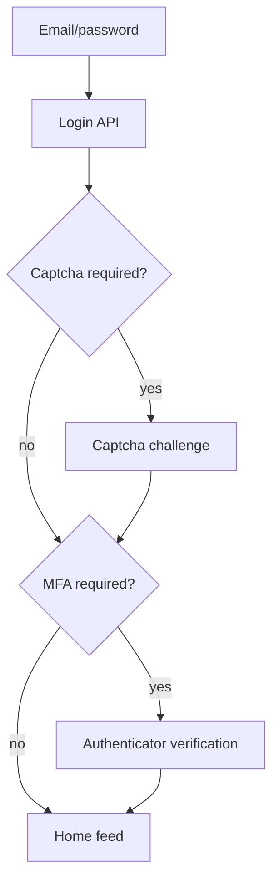

# Streamly Auth Flow

## Login Flow



## Supported Methods

- Email/password.
- Email OTP.
- SMS OTP.
- WhatsApp OTP.
- Authenticator MFA.
- Smart captcha.
- MFA trust token.

## Frontend State

Auth state lives in `stores/auth-store.ts`.

```txt
anonymous -> partial -> authenticated
```

## Security Rules

- Do not log passwords.
- Do not store passwords after submit.
- Do not expose token values.
- Do not infer whether an email exists.
- Use backend-provided MFA and captcha decisions.
- Keep route gates separate from UI components.
