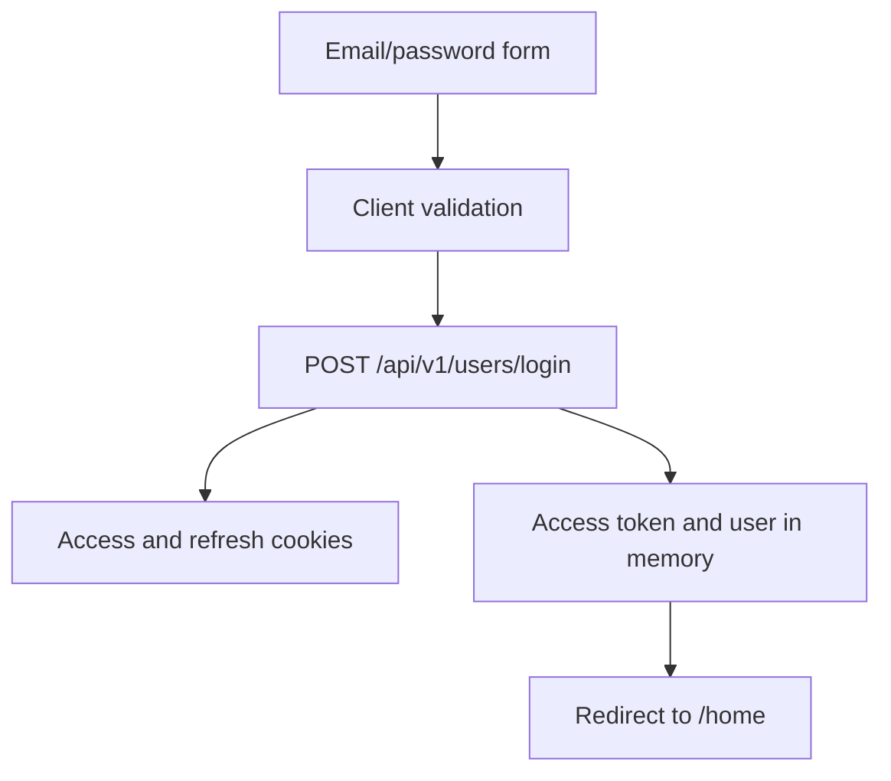

# Streamly Auth Flow

## Login Flow



## Supported Methods

- Email/password is wired.
- Email OTP is prepared and pending frontend wiring.
- SMS OTP is prepared and pending frontend wiring.
- WhatsApp OTP is prepared and pending frontend wiring.
- Authenticator MFA is prepared and pending frontend wiring.
- Smart captcha is prepared and pending provider wiring.
- MFA trust token is backend-supported.

## Actual Backend Routes

```txt
POST /api/v1/users/login
POST /api/v1/users/refresh-token
POST /api/v1/users/logout
POST /api/v1/users/logout-all
GET  /api/v1/users/current-user
```

Advanced backend routes:

```txt
POST /api/v1/users/auth/signup/start
POST /api/v1/users/auth/signup/verify-email
POST /api/v1/users/auth/signup/phone/start
POST /api/v1/users/auth/signup/phone/verify
POST /api/v1/users/auth/signup/mfa/setup
POST /api/v1/users/auth/signup/mfa/verify
POST /api/v1/users/auth/login/start
POST /api/v1/users/auth/login/verify-otp
POST /api/v1/users/auth/login/verify-mfa
```

## Frontend State

Auth state lives in `stores/auth-store.ts`.

```txt
anonymous -> partial -> authenticated
```

Stored state:

- user
- status
- access token in memory
- bootstrapping flag
- loading flag
- user-facing error

Refresh tokens remain backend-owned through secure cookies.

## Route Guards

Guest-only routes redirect authenticated users to `/home`.

Protected routes redirect anonymous users to `/login`.

Admin routes accept either `admin` role or `user:admin` permission.

## Security Rules

- Do not log passwords.
- Do not store passwords after submit.
- Do not expose token values.
- Do not infer whether an email exists.
- Use backend-provided MFA and captcha decisions.
- Keep route gates separate from UI components.
