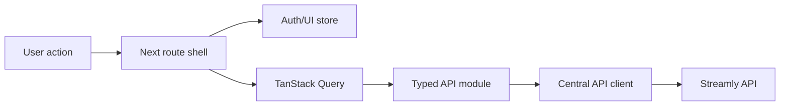

# Streamly Frontend Architecture

## Stack

- Next.js App Router
- TypeScript
- Tailwind CSS
- TanStack Query
- Zustand
- Framer Motion-ready motion tokens
- Lucide React icons

## Architecture Goals

- Keep screens thin.
- Keep API access centralized.
- Keep auth state isolated.
- Keep visual tokens reusable.
- Keep components composable.
- Keep route protection explicit.

## Folder Structure

```txt
frontend/
  app/                 route shells and layouts
  components/          reusable UI, layout, auth, video, feedback components
  hooks/               reusable UI/domain hooks
  lib/
    api/               API client and endpoint modules
    auth/              auth contracts and route guard helpers
    config/            frontend env config
    constants/         nav and sample shell content
    motion/            motion tokens
    theme/             theme provider
    validation/        shared validation rules
    utils/             focused utilities
  stores/              Zustand stores
  styles/              reserved for future extracted styles
  docs/                product and implementation docs
```

## Dependency Direction

```txt
app routes
  -> components
  -> hooks/stores
  -> lib/api, lib/auth, lib/theme
  -> backend API
```

Components do not call backend services directly unless they are route-level
or feature-level orchestration components. Shared UI stays presentation-only.

## Request Lifecycle



## Route Groups

- Public: landing, login, signup, loading, offline.
- Optional auth: explore and watch shells.
- Auth required: home, settings, studio.
- Role gated: admin and future moderation routes.

## Refactoring Standard

Every frontend module should have one reason to change. Shared components
should be variant-driven and avoid backend knowledge. API modules should
own endpoint paths and response contracts.
